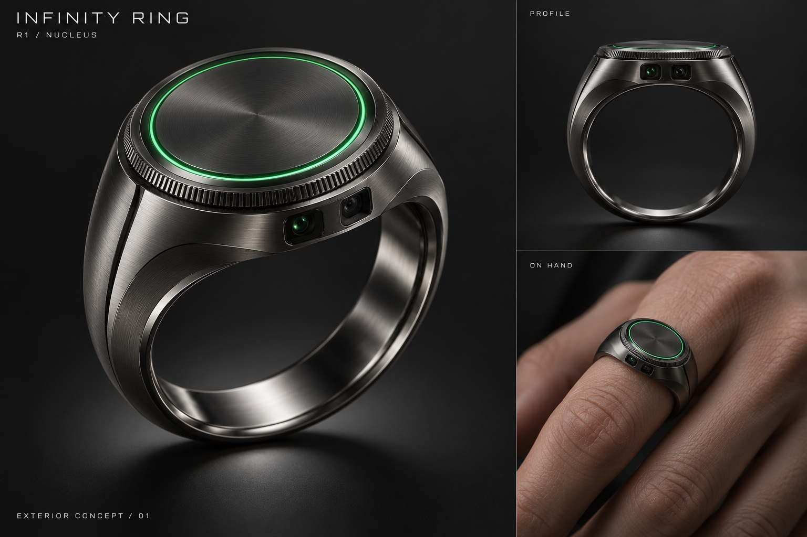
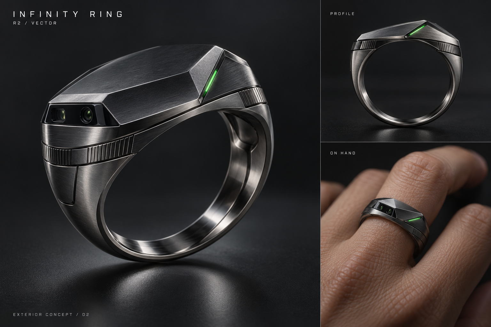
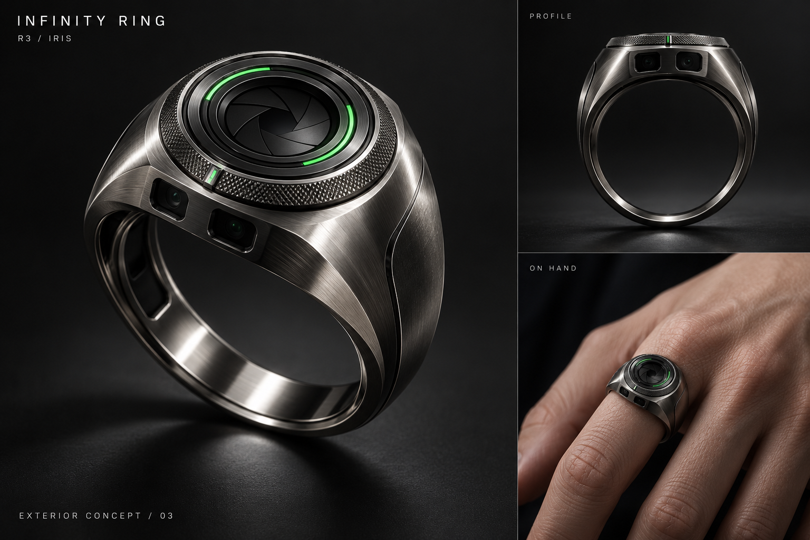
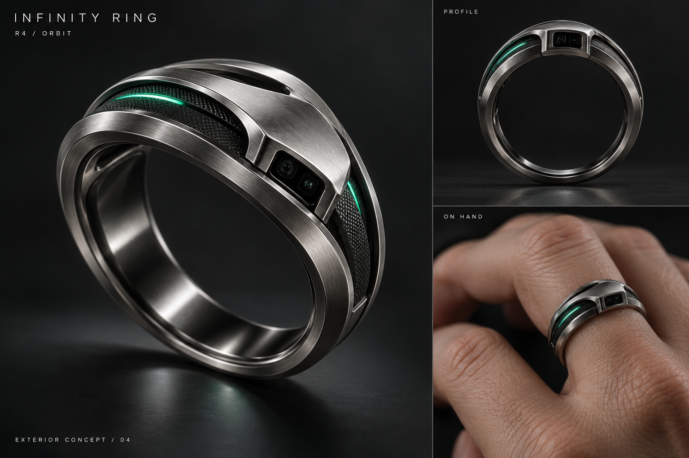

# Infinity Ring — 外观第一轮

网站视觉已由用户确认 A＋C：黑色精密产品展示与自然光佩戴场景。此次只选择戒指外形，不重新选择网站风格。

用户新要求：灵感来自《Lanterns》中 Hal Jordan 的戒指；收敛夸张感，同时比上一轮普通宽戒更有科技感。

## 共用设计语言

石墨钛金属、克制的绿色状态光、可辨认的机械控制结构、内嵌光学窗口、较窄且圆润的下半环。科技感来自轮廓、层次和光学细节。保持原创，沿用产品资料中没有宝石、徽章和魔法粒子的方向。

每张图含三分之四主视图、侧面视图和佩戴视图，用于对比外形与视觉比例。图像为 AI 生成概念；不同视图可能存在微小差异，选定后需统一成一个三维模型。这一轮不证明实际装配尺寸、舒适度或硬件可行性。

| 方案 | 外形区别 | 想表达的感觉 | 后续动画适配 |
|---|---|---|---|
| R1 · Nucleus / 核心 | 低矮圆形顶面、细绿光围绕金属中心、顺滑肩部 | 克制的能量核心，最接近用户描述的灵感方向 | 顶部唤醒、沿圆形边缘展开、顺滑合体 |
| R2 · Vector / 矢量 | 浅楔形顶面、明确切面与斜向细光、整体收窄 | 更锐利、更具未来仪器感 | 沿切面定向拆分，斜向接入目标场景 |
| R3 · Iris / 虹膜 | 内凹同心光学面、细密旋转边缘、深色中心 | 精密光学与控制感最明显 | 旋转特写、光学聚焦、选区调节具有直接视觉联系 |
| R4 · Orbit / 双轨 | 两道金属外轨包覆暗色中环、错位顶部连接、间隙细光 | 分层结构与现代科技首饰感 | 两轨、中环和内衬错峰展开，层次清晰 |

## 外部参考记录

- 官方剧集身份与角色来源：[HBO / WBD](https://press.wbd.com/emea/ca/media-release/hbo-max/lanterns/hbo-max-releases-first-teaser-dc-studios-series-lanterns-starring-kyle-chandler-aaron)。
- 检索到的戒指特写报道：[GamesRadar+，图片标注 DC Studios](https://www.gamesradar.com/entertainment/dc-tv-shows/hbos-first-teaser-for-its-green-lantern-show-is-11-seconds-of-pure-adrenaline/)。
- 参考仅用于定位用户所指的剧集版本与灵感方向，没有把影视道具图作为本项目产品资产，也没有声称精确还原道具几何。

## 当前选择

用户已选择 R3 · Iris，原话「我喜欢R3」。本轮选择已完成，下一步统一为网站中的同一产品身份。R1、R2、R4 仅保留为历史方案，不再等待选择。

原图与本轮完整生成提示词保存在 `../direction/exterior-round-01/`。

## 四款原图

### R1 · Nucleus

### R2 · Vector

### R3 · Iris

### R4 · Orbit

